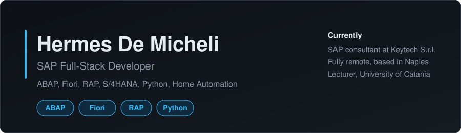

<h3>Hermes De Micheli</h3>

SAP Full-Stack Developer (ABAP, Fiori, RAP) at Keytech S.r.l. | Naples, Italy | Hybrid

<a href="#about">About</a> &nbsp;|&nbsp;
<a href="#tech-stack">Tech Stack</a> &nbsp;|&nbsp;
<a href="#featured-projects">Projects</a> &nbsp;|&nbsp;
<a href="#experience">Experience</a> &nbsp;|&nbsp;
<a href="#certifications">Certifications</a> &nbsp;|&nbsp;
<a href="#contact">Contact</a>

---

## About

Since June 2022 I have been building and maintaining SAP S/4HANA systems at Keytech, across most modules. Day to day that means Fiori apps on CDS views and OData, Adobe Forms, Smartforms, reports, enhancements, user exits and AMS tickets for client systems.

The part I enjoy most is untangling old code. I rewrote the MV45AFZZ user exit from procedural ABAP into a class with methods, and I like it when a messy report ends up readable enough that the next person can change it without fear. I also write the technical documentation for the projects I deliver, because someone has to explain them after go-live. In 2024 I taught an ABAP course, and in 2026 I gave a lecture at the University of Catania on the ABAP Dictionary and debugging.

Outside work I build with Python and FastAPI, and I run a Home Assistant setup on an Android phone. The hardware budget is small, so every service has to earn its place.

---

## Tech Stack

**SAP**

**Languages**

**Tools**

Also: RF and RFC, Smartforms, SFTP exchange, technical documentation, Microsoft Windows Server

---

## Public Projects

| Project | Description | Tech |
|---|---|---|
| [sap-orchestrator](https://github.com/Hermes-DeMicheli/sap-orchestrator) | Orchestration framework for multi-system SAP landscapes. |  |

---

## Experience

**SAP Consultant, Keytech S.r.l.** (Naples, June 2022 to present)

- S/4HANA enhancements and fixes across modules
- Rewrote the MV45AFZZ user exit (SD) from procedural ABAP to a class with methods
- Treasury reports and SFTP file exchange
- Fiori and Adobe Forms development for client projects
- Technical documentation for delivered projects
- Taught an ABAP course (2024) and gave a lecture at the University of Catania (2026)

---

## Certifications

- SAP Certified Associate, Back-End Developer, ABAP Cloud (2024)
- Anthropic courses on Claude and Claude Code (2026)

**Languages:** Italian (native), English (B2)

---

## Contact

